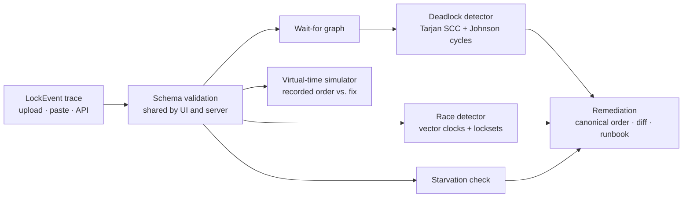

# DeadlockZero

[](https://github.com/akilaymaan/deadlock-zero/actions/workflows/ci.yml)
[](./LICENSE)
[](./package.json)

DeadlockZero analyzes lock traces from concurrent programs. Give it a list of lock and memory events (which worker acquired, waited on, released, read, or wrote which resource), and it:

- builds the **wait-for graph** and finds every **deadlock cycle** (Tarjan's strongly connected components, then Johnson's elementary cycles);
- finds **data races** — conflicting accesses whose **vector clocks** are concurrent and that share no lock;
- flags **resource starvation** when more than 80% of workers are blocked on one resource;
- generates **remediation guidance**: the canonical lock order, each worker's observed vs. required order, a suggested code pattern, a unified diff, and an incident checklist;
- runs a **deterministic stress-test simulation** that replays the trace's lock steps across many virtual workers, before and after the suggested fix.

It is aimed at backend and SRE engineers debugging lock-ups, intermittent hangs, or lost updates in services, databases, and distributed systems who can export (or reconstruct) a lock trace.

> **Status:** pre-1.0 (`0.2.0`, unreleased). The API and trace format may still change. See [Limitations](#limitations).

## Contents

- [How it works](#how-it-works)
- [Quick start](#quick-start)
- [Trace format](#trace-format)
- [HTTP API](#http-api)
- [Configuration](#configuration)
- [Development](#development)
- [Deployment](#deployment)
- [Limitations](#limitations)
- [Security](#security) · [Contributing](#contributing) · [License](#license)

## How it works



| Component | File | Notes |
| --- | --- | --- |
| Trace validation | `src/shared/traceValidation.ts` | Same rules in the browser and the API |
| Wait-for graph | `src/engine/graph.ts` | Events processed in timestamp order |
| Deadlock detection | `src/engine/deadlockDetector.ts` | O(V + E) SCC pass, then elementary-cycle enumeration within cyclic SCCs |
| Race & starvation detection | `src/engine/raceDetector.ts` | Happens-before via vector clocks; common-lock suppression |
| Remediation | `src/engine/remediator.ts` | Derived from the trace; output is a **suggestion to review**, not a verified patch |
| Simulator | `src/engine/simulator.ts` | Seeded, virtual-time; see [Simulation model](#simulation-model) |
| HTTP server | `src/server/` | Express 5; stateless; serves the built UI |
| Web UI | `src/client/` | React 19 + Tailwind CSS 4; three steps: Diagnose, Fix, Stress-test |

Analysis in the web UI runs locally in the browser. Only the stress test is sent to the server (`POST /api/benchmark`). There is no database: the server is stateless and stores nothing.

### Simulation model

Each worker in the trace becomes a program: its ordered lock acquisitions (`ACQUIRE`/`WAIT`) and accesses (`READ`/`WRITE`). N virtual workers replay those programs round-robin under a seeded random scheduler with real lock ownership:

- a worker blocked for `deadlockDetectionMs` (default 1000 ms, like PostgreSQL's `deadlock_timeout`) checks for a wait-for cycle once; if one exists, one victim request is aborted;
- a worker blocked for `lockTimeoutMs` (default 10 000 ms) aborts its request;
- an access to a resource the worker does not hold a lock on is unprotected; two in-flight requests touching the same resource unprotected, at least one writing, count as a race and both fail.

The "after" run applies the suggested fix: every lock set sorted into the canonical order, plus a guard lock for every unprotected resource. Results are deterministic for a given trace, options, and seed. Runs are bounded by a virtual-time budget and a CPU budget; a run that hits either reports `truncated: true`.

The model captures **ordering and synchronization only**. It does not know your real I/O or critical-section durations, so it is evidence that a fix removes a cycle or race, not a load test. Starvation caused by long hold times, for example, shows no change because lock ordering does not fix it.

## Quick start

Requirements: Node.js 22 (`.nvmrc` pins `22.19.0`) and npm.

```bash
npm ci
npm run build
npm start            # http://localhost:3000
```

Then open the page and upload a `.json`/`.jsonl` trace, or paste one into the editor ("Insert schema example" fills in a two-event documentation example).

With Docker:

```bash
docker build -t deadlock-zero .
docker run --rm -p 3000:3000 deadlock-zero
```

## Trace format

A trace is a JSON array of events, an object `{ "events": [...] }`, or JSONL (one event per line).

| Field | Type | Required | Meaning |
| --- | --- | --- | --- |
| `workerId` | string (≤ 512 chars) | yes | Thread, process, or service that acted |
| `resourceId` | string (≤ 512 chars) | yes | Lock, row, key, or memory location acted on |
| `action` | `ACQUIRE` \| `WAIT` \| `RELEASE` \| `READ` \| `WRITE` | yes | `WAIT` means "requested and blocked" |
| `timestamp` | number ≥ 0 | no | Ordering; defaults to the event's position |
| `vectorClock` | object of non-negative integers | no | Needed for race detection |
| `id` | string | no | Defaults to `evt-<n>` |
| `file`, `line`, `codeSnippet` | string, positive integer, string (≤ 2000 chars) | no | Shown in the report and diff |

Documentation example (two workers acquiring two locks in opposite orders — a classic AB-BA deadlock):

```json
{
  "events": [
    { "workerId": "w1", "resourceId": "A", "action": "ACQUIRE", "timestamp": 1, "file": "src/transfer.ts", "line": 10 },
    { "workerId": "w2", "resourceId": "B", "action": "ACQUIRE", "timestamp": 2, "file": "src/transfer.ts", "line": 10 },
    { "workerId": "w1", "resourceId": "B", "action": "WAIT",    "timestamp": 3, "file": "src/transfer.ts", "line": 11 },
    { "workerId": "w2", "resourceId": "A", "action": "WAIT",    "timestamp": 4, "file": "src/transfer.ts", "line": 11 }
  ]
}
```

## HTTP API

All `POST` endpoints require `Content-Type: application/json`, are rate limited per client, and return errors as `{ "error", "code", "details"?, "requestId" }`.

| Method & path | Purpose |
| --- | --- |
| `GET /api/health` | Liveness: `{ status: "ok", service, version }` |
| `GET /api/ready` | Readiness: `{ status: "ready", checks: { api, frontendAssets } }` |
| `POST /api/analyze` | Body `{ events, sourceCode? }` → `{ summary, graph, cycles, races, starvation, remediation }` |
| `POST /api/benchmark` | Body `{ events, workers?, requestsPerWorker?, seed? }` → `{ config, canonicalLockOrder, before, after, improvementFactor }` |

`sourceCode`, if given, replaces the trace-derived snippet as the "before" side of the diff. `improvementFactor` is `after` throughput ÷ `before` throughput, or `null` when the recorded order completed no requests.

| Status | `code` | When |
| --- | --- | --- |
| 400 | `INVALID_EVENTS_PAYLOAD` | Schema violation; `details` lists each `field` and `message` |
| 400 | `INVALID_JSON` | Body is not valid JSON |
| 413 | `TRACE_TOO_LARGE` / `PAYLOAD_TOO_LARGE` | More than `MAX_TRACE_EVENTS` events / body over `BODY_LIMIT_BYTES` |
| 415 | `UNSUPPORTED_MEDIA_TYPE` | Missing JSON content type |
| 422 | `UNSIMULATABLE_TRACE` | Trace has no lock or access steps to simulate |
| 429 | `RATE_LIMITED` | Rate limit exceeded; see `Retry-After` |
| 500 | `INTERNAL_ERROR` | Unexpected failure; details are logged server-side with the `requestId` |

```bash
curl -s -X POST http://localhost:3000/api/analyze \
  -H 'Content-Type: application/json' \
  -d @trace.json | jq .summary
```

## Configuration

The server reads environment variables (and a `.env` file in the working directory, if present). All are optional. Invalid values stop the server at startup with a clear message. See [`.env.example`](./.env.example).

| Variable | Default | Purpose |
| --- | --- | --- |
| `PORT` / `HOST` | `3000` / `0.0.0.0` | Listen address |
| `NODE_ENV` | `development` | Reported in logs |
| `LOG_LEVEL` | `info` | `debug`, `info`, `warn`, `error`, `silent`; JSON lines on stdout |
| `CORS_ORIGIN` | empty | Comma-separated allowed origins; empty = same-origin only |
| `TRUST_PROXY` | `false` | Trust `X-Forwarded-For` (enable only behind a trusted proxy) |
| `RATE_LIMIT_WINDOW_MS` / `RATE_LIMIT_MAX` | `60000` / `60` | Per-client limit for the `POST` endpoints |
| `MAX_TRACE_EVENTS` | `10000` | Events per request |
| `BODY_LIMIT_BYTES` | `2000000` | Request body size |
| `SIMULATION_WORKERS` / `MAX_SIMULATION_WORKERS` | `500` / `5000` | Default and maximum virtual workers |

No external services, API keys, or databases are required.

## Development

```bash
npm ci
npm run dev:server   # API on :3000 with reload (tsx watch)
npm run dev          # UI on :5173, proxies /api to :3000
```

| Command | What it does |
| --- | --- |
| `npm run typecheck` | Strict TypeScript check (`noUnusedLocals`, `noUnusedParameters`) |
| `npm test` | All tests (Vitest): engine, simulator, API integration, config, client parsing, repository hygiene |
| `npm run build` | Clean, typecheck, build the UI to `dist/client` and the server to `dist/server` |
| `npm start` | Run the built server (`node dist/server/index.js`) |
| `npm run audit` | `npm audit` for production dependencies (high severity and up) |

Tests run offline and need no services. There are no browser end-to-end tests yet; UI logic that can be tested without a DOM (trace parsing, the timeline) is covered in `tests/client-lib.test.ts`.

## Deployment

The `Dockerfile` is multi-stage: the build stage runs `npm ci`, `npm test`, and `npm run build`; the runtime stage installs production dependencies only (`express`, `cors`), runs as the unprivileged `node` user, and defines a `HEALTHCHECK` against `/api/health`.

```bash
docker build -t deadlock-zero .
docker run --rm -p 3000:3000 --env-file .env.example deadlock-zero
```

Operational notes:

- **Stateless:** no volumes, migrations, or backups are needed. Scale horizontally behind a load balancer; note that the rate limiter is in-memory, per instance.
- **No authentication:** the API has no user accounts. Anyone who can reach it can submit traces. If you expose it beyond a trusted network, put it behind an authenticating reverse proxy, and set `TRUST_PROXY=true` there so rate limiting sees real client IPs.
- **TLS:** terminate TLS at the proxy. The server does not send HSTS itself.
- **CPU:** analysis and simulation run on the request thread. Each simulation is capped at roughly 0.5 s of CPU per run (two runs per request) and rate limited, but a busy instance will queue requests behind it.
- **Shutdown:** `SIGTERM`/`SIGINT` stop accepting connections and exit after in-flight requests finish (forced after 10 s).
- **Logs:** one JSON object per line with `requestId`, method, path, status, and duration. Trace contents and request bodies are never logged.

## Limitations

- Trace ingestion is a JSON/JSONL schema; there are no adapters yet for specific database, runtime, or tracing-system formats. You need to export or convert your lock events.
- Deadlock detection considers the lock state at the end of the trace (current holders and outstanding waits). A trace that only contains locks already released will show no cycle.
- `RELEASE` events update the wait-for graph but are ignored by the simulator, which releases all of a request's locks when the request finishes.
- The remediation code is a generated pattern. It cannot see your codebase and must be adapted and reviewed.
- The simulator is a model; see [Simulation model](#simulation-model).

## Security

Please report vulnerabilities privately. See [SECURITY.md](./SECURITY.md).

## Contributing

Contributions are welcome. See [CONTRIBUTING.md](./CONTRIBUTING.md) and the [Code of Conduct](./CODE_OF_CONDUCT.md).

## License

[MIT](./LICENSE). Runtime and bundled dependencies use MIT, ISC, or BSD-3-Clause licenses; the client bundle includes React (MIT) and Lucide icons (ISC).
